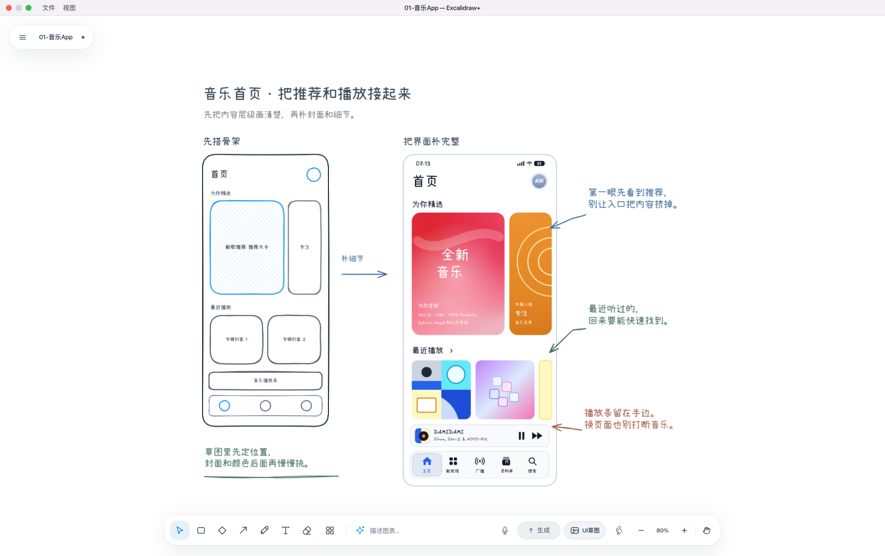
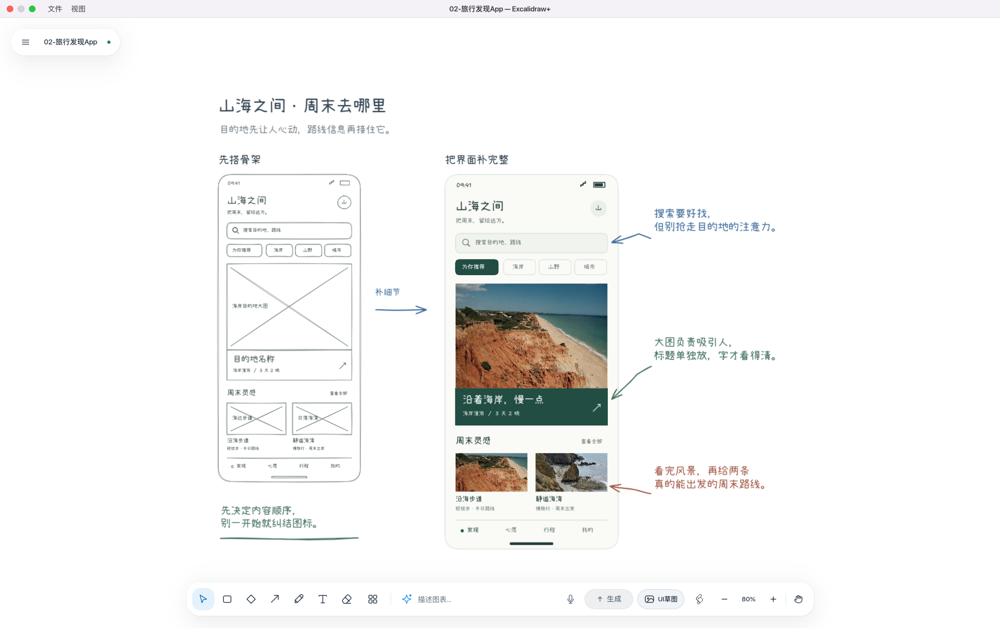
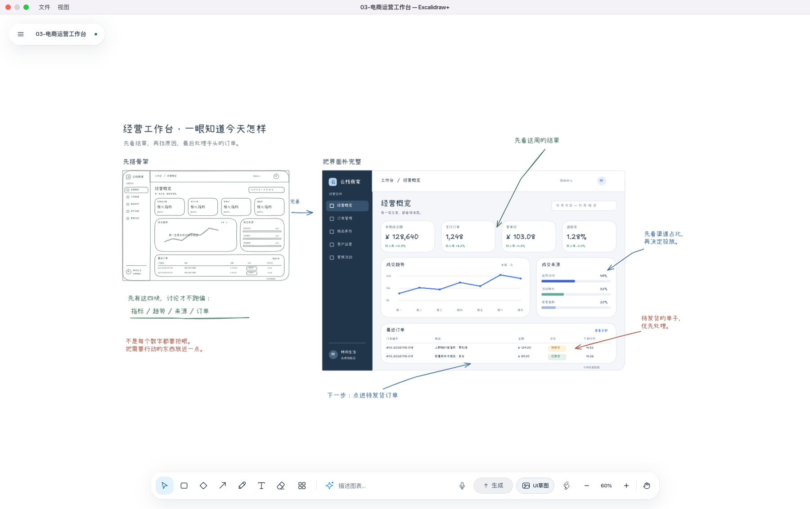
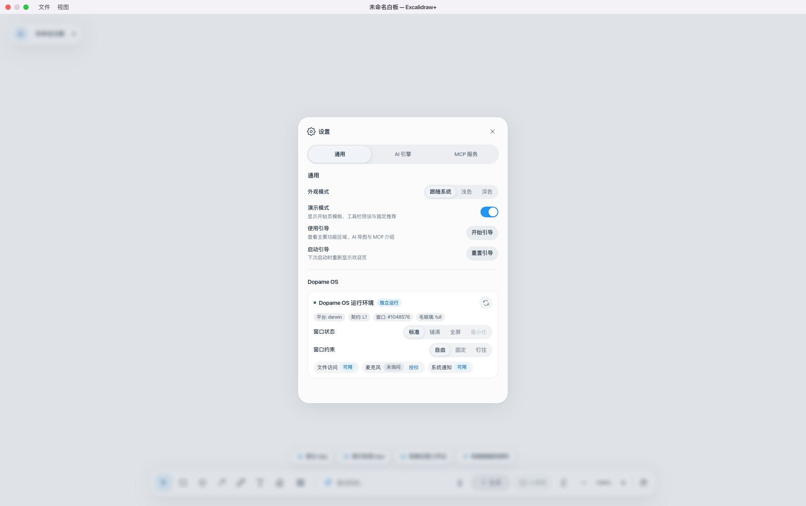

# 00 · 准备与演示

## 最省事的打开方式

打开 `demo/boards/01-音乐App.excalidraw`。里面已经有草图、完成界面和批注。文件内图片齐全，展示现成内容无需联网。

## 依次看三个案例

1. **音乐 App，约 45 秒**：从左到右说明推荐、最近播放、播放条。放大完成界面，选中一段批注移动一下，证明内容可编辑。
2. **旅行 App，约 45 秒**：看搜索、目的地图片与标题、下面两张周末路线卡。指出草图和成品的区域位置是对应的。
3. **电商工作台，约 60 秒**：先看四项数字，再看趋势和来源，最后指向待发货订单。数字是示例经营数据，折线和渠道条都可编辑。
4. **收尾，约 20 秒**：修改一条旁注，撤销，再另存为自己的版本。

## 如果要现场演示草图转界面

「菜单 → 设置 → 通用」开启演示模式，再用底部「预设模板」插入单独的案例草图。点击「UI草图 → 整页生成」。这些固定示例可本地完成。

现成白板中同时摆了草图、成品和说明，适合讲解与编辑；现场转换请使用预设入口新插入的草图。步骤见 [06](06-UI草图与固定案例.md)。

