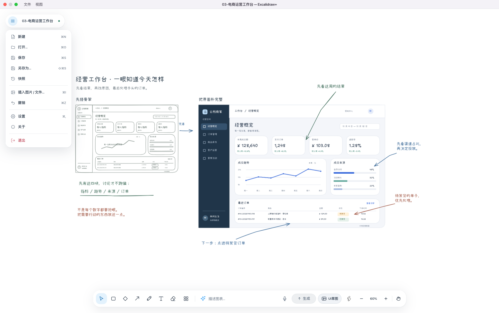
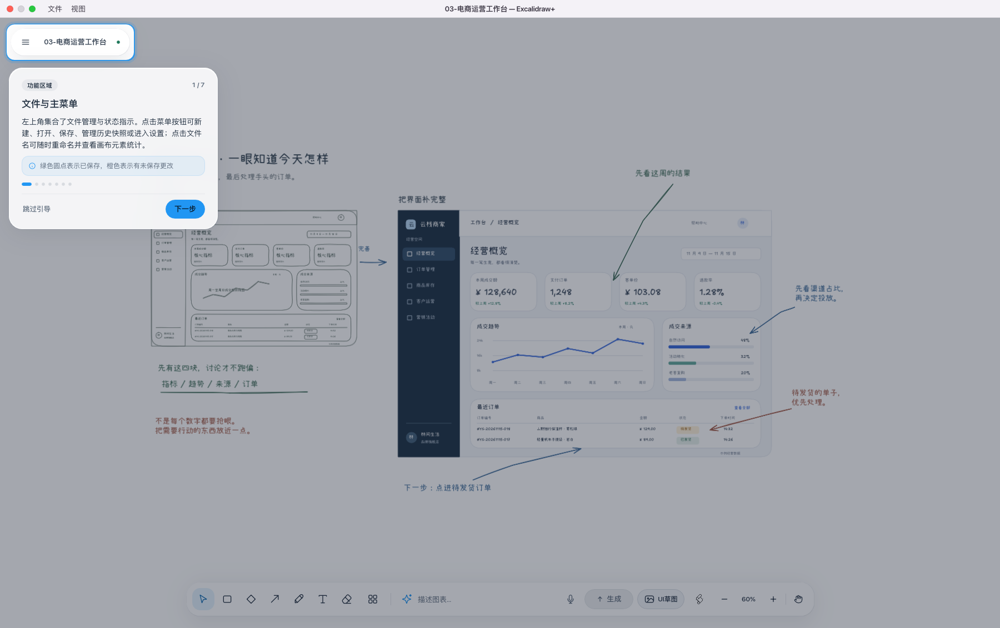

# 01 · 文件与主菜单

1. 点击左上角菜单，可以新建、打开、保存、另存为、管理快照和进入设置。
2. 打开本目录 `boards/` 的文件；打开后画布会自动适配内容。
3. 点击文件名可改名或查看文档信息。
4. 编辑后使用「保存」写回文件；想保留原版，用「另存为…」。
5. 使用「快照」保存一个阶段，之后可回到这个版本。恢复前先保留当前版本。

绿色状态点表示已保存，橙色表示有更改。打开别的文件前若出现保存确认，按实际需要选择保存、不保存或取消。

**动手试一下**：把右侧某条批注改成自己的话，另存为一份，再重新打开。

## 应用内对应引导

回到 [演示目录](../README.md)。
