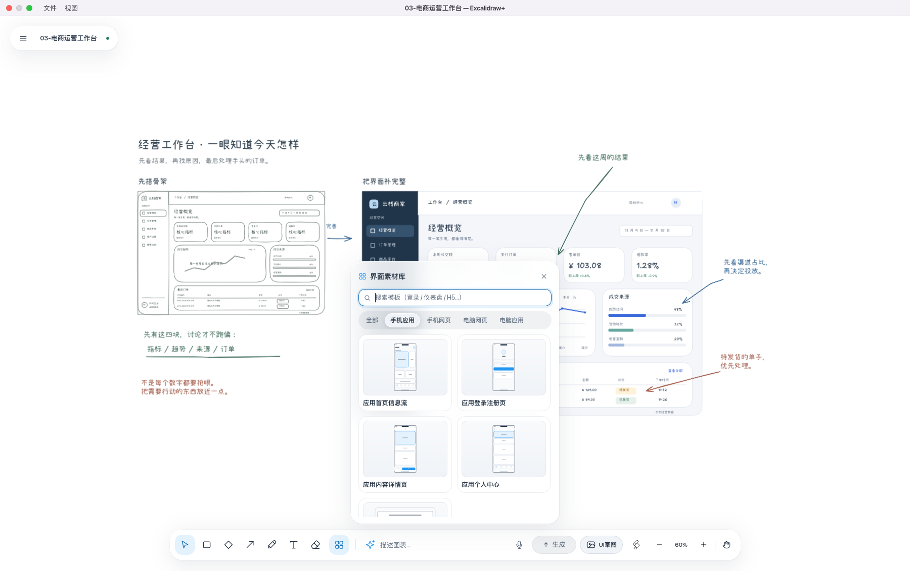
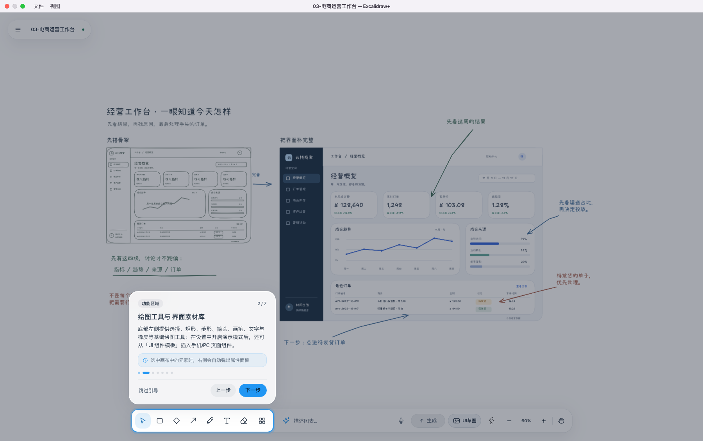

# 02 · 绘图工具与界面素材库

1. 使用底部「选择」工具点击文字、箭头、卡片，可移动和调整大小。
2. 选择矩形、菱形、箭头、画笔、文字或橡皮，在空白位置添加内容。窄窗口中部分工具会收入「更多工具」。
3. 选中元素后，在属性面板调整颜色、线宽、文字等可用属性。
4. 开启演示模式后，点击「UI 组件模板」打开素材库；按手机应用、手机网页、电脑网页、电脑应用筛选，也可以直接搜索。
5. 点击模板卡片插入画布，再继续修改。素材库里的元素与这三张示例白板一样可编辑。

**动手试一下**：在空白处补一句“这个入口再想一下”，画一根箭头指向对应区域。把元素选中后按删除键移除；用菜单「撤销」恢复。

## 应用内对应引导

回到 [演示目录](../README.md)。
