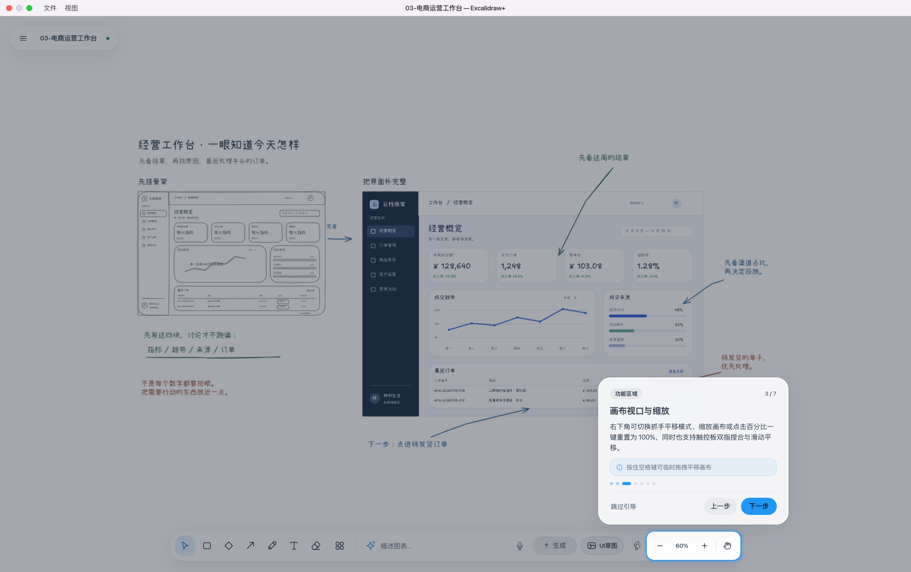

# 03 · 画布视口与缩放

1. 在底部的缩放控件中使用加号、减号查看细节或全局。
2. 点击百分比重置为 100%。小窗口可能先显示放大镜按钮，点击后展开视图控件。
3. 抓手工具用于拖动画布；按住空格也可以临时平移。
4. 触控板可双指平移和捏合缩放。

**动手试一下**：先看整张“电商运营工作台”，再放大到最近订单，读一下右侧批注；最后缩回全局。

这里是在调整观看范围。要改变某张卡片的实际尺寸，需要用选择工具调整元素。

## 应用内对应引导

回到 [演示目录](../README.md)。
