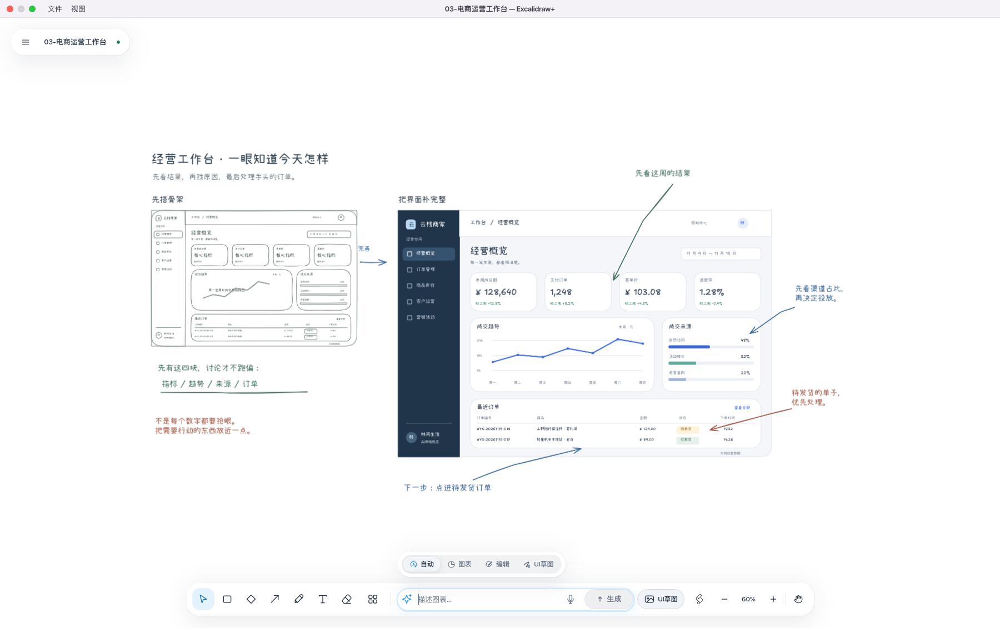
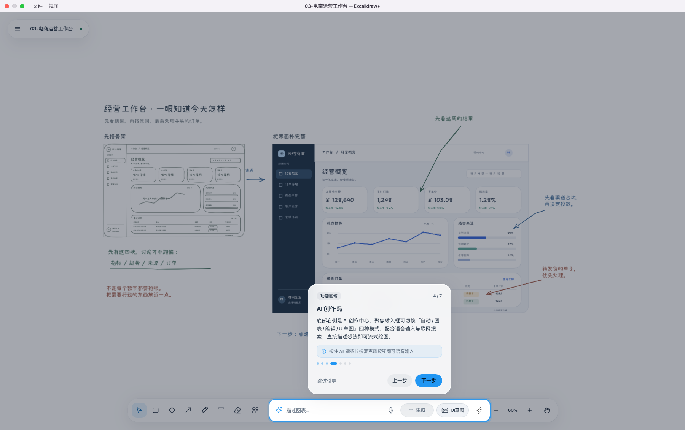

# 04 · AI 创作岛

1. 点击底部描述输入框，展开模式选择。
2. 「自动」适合直接表达需求；「图表」用于流程、架构与导图；「编辑」用于修改画布；「UI草图」用于识别草图布局。
3. 输入需求，点击「生成」。输入法组词完成后再提交；需要换行时使用 Shift+Enter。
4. 支持麦克风时，按住 Alt 或长按麦克风说话，松开后等待识别。
5. 配置允许时可切换联网搜索。生成结果是否包含来源取决于实际使用的工具。

**可以这样说**：“把这个入口的说明改短一点，其他内容保留。”

普通 AI、语音识别和联网搜索需要相应服务配置与网络。截图展示实际模式入口，没有发起在线请求或录音。

## 应用内对应引导

回到 [演示目录](../README.md)。
