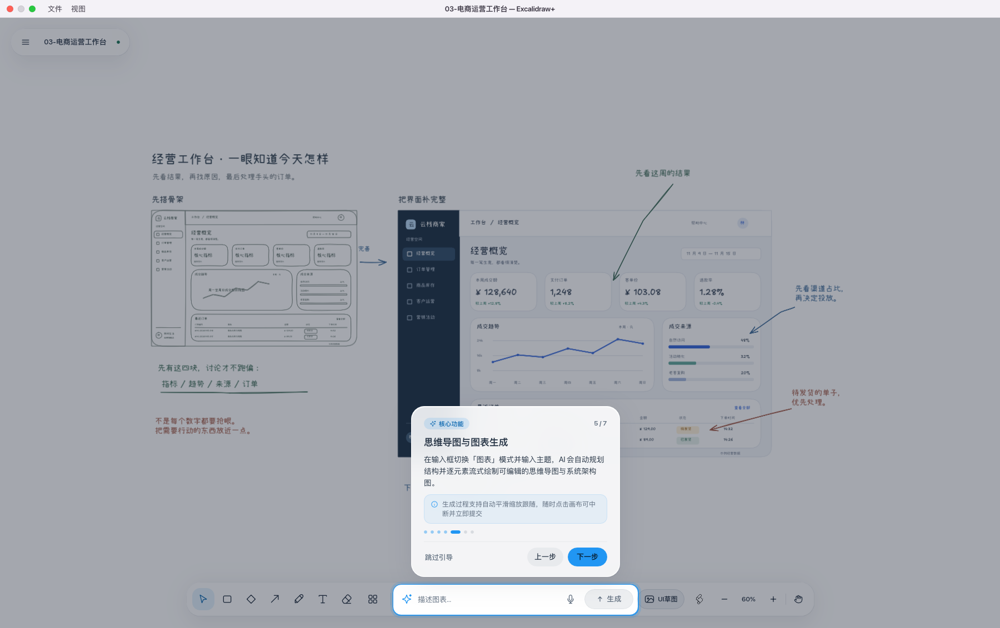

# 05 · 思维导图与图表生成

1. 点击描述输入框，选择「图表」。
2. 写清主题和希望出现的节点，例如：“画一个订单处理流程，包含创建订单、支付、扣库存、发货和完成；支付失败可以重试。”
3. 点击生成，等待结构规划与逐元素绘制。
4. 生成后可以选中文字改名、移动节点，或继续用 AI 编辑。
5. 需要结束绘制动画时，点击画布可立即提交完整结果；撤销可回到前一步。

**另一条可用提示词**：“把产品上线拆成需求调研、设计、开发、测试、发布和复盘，用思维导图表达。”

图表入口走在线生成，并非本目录三套固定 UI 案例。演示前先配置好服务；只展示现成白板则无需调用在线模型。

## 应用内对应引导

回到 [演示目录](../README.md)。
