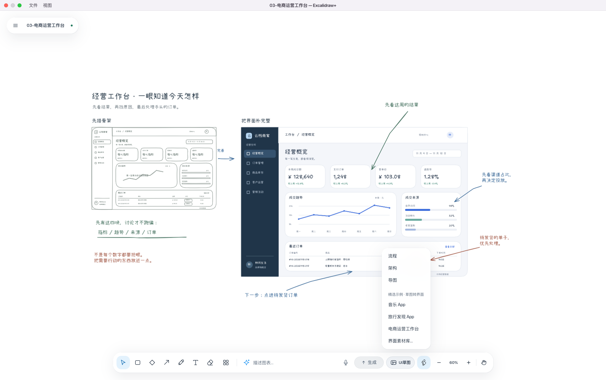
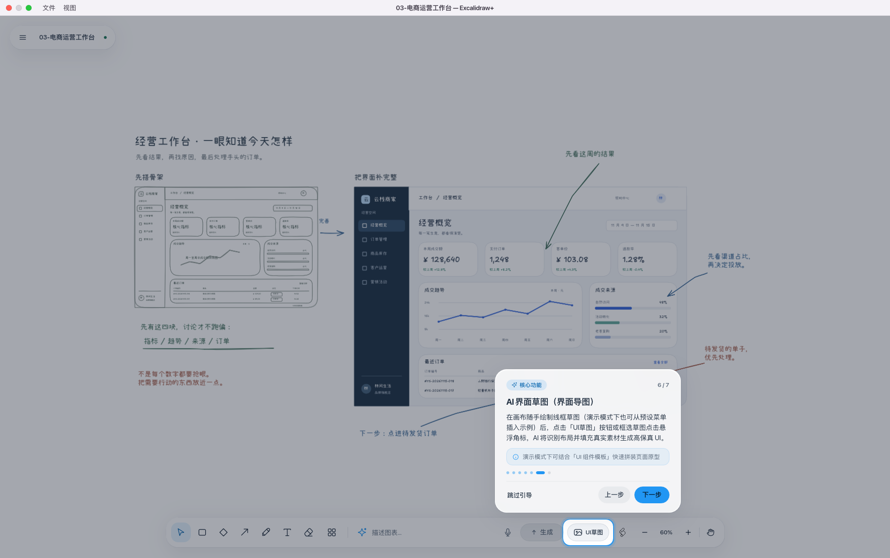

# 06 · UI 草图与固定案例

## 展示已经做好的文件

直接打开 `boards/` 中任意文件。左右两边分别是草图和完成界面，边上的箭头、文字和下划线可继续改。

## 现场跑一次固定案例

1. 在「菜单 → 设置 → 通用」开启演示模式。
2. 用底部「预设模板」选择音乐 App、旅行发现 App 或电商运营工作台，插入草图。
3. 点击「UI草图」。只有这一套草图时，选择「整页生成」。
4. 如果画布上还有其他案例，先框选其中一套完整草图，再选择「生成选中区域 UI」。
5. 完成后检查布局对应关系，再改文字或移动元素。可以单步撤销恢复草图。

## 使用自己画的草图

画出外框、主要容器和文字，再选择相应区域生成。普通草图需要在线识别，生成细节与固定案例不同。尽量标明“标题、图片、列表、按钮”等内容职责。

**演示小提示**：现成白板用于打开、讲解和编辑；要展示固定转换，请从预设入口重新插入完整草图。复制一份带标记的草图后直接转换可能出现重新插入的提示。

## 应用内对应引导

回到 [演示目录](../README.md)。
