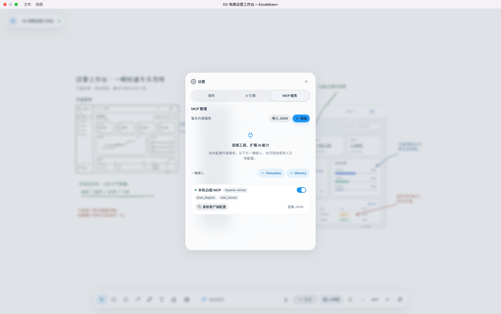
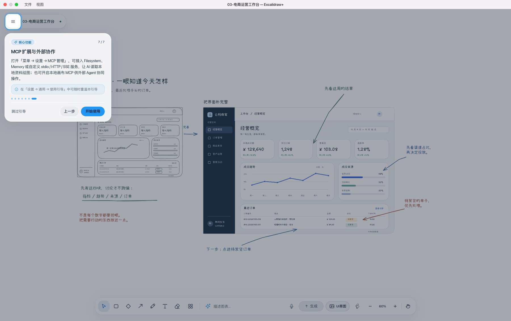

# 07 · MCP 扩展与协作

1. 打开「菜单 → 设置 → MCP 服务」。
2. 按用途选择 Filesystem、Memory，或添加自定义本地进程、HTTP、SSE 服务。
3. Filesystem 需要设置可访问的目录；Memory 用于存取结构化记忆。配置完成后连接服务，检查连接状态和工具列表。
4. 连接资料服务后，可以要求 AI 根据真实资料绘图，例如：“读取演示目录里的订单说明，画出订单到支付、库存和通知的关系。”
5. 若要让外部智能体控制当前画布，开启本地画布 MCP，并把界面提供的连接配置交给客户端。

本次交付只提供说明和截图，没有替你连接外部服务或开放本地目录。展示三个现成白板不需要 MCP。

需要更详细的工具和接入协议时，参考项目内的 `docs/MCP.md`（位于项目根目录）。

## 应用内对应引导

回到 [演示目录](../README.md)。
