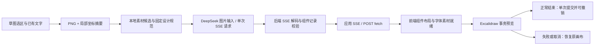

# 可编辑 UI 草图：端到端流式生成完整方案

日期：2026-11-15。状态：研究与推荐设计，未实现、未通过线上性能验收。用户明确要求：真实流式，质量提升，速度尽量不变。下文的交互默认值和技术取舍是本次建议，不代表用户已逐项确认。

视觉标准：应保留草图主要区域，组合真实配图、清晰文字层级、卡片、导航与可编辑图表/表格；仅增加图片数量不能算达到目标。已补充购物/科技各 10 张本地视觉素材，清单见 docs/ui-assets/README.md；完整流式生成仍需按本文实现与验收。

本方案更新此前研究的优先级：流式是第一阶段必交付能力，不再作为后续可选项。此前研究见 `docs/ui-sketch-quality-research.md`。

## 1. 推荐决策

采用：原生图片输入 + 单次模型调用 + 紧凑组件描述流 + 本地确定性布局 + Excalidraw 分批预览 + 成功后单次提交。

默认保留 deepseek-flash、关闭思考作为速度基线；在同一流式链路上实验 low 思考。最终结果必须为可编辑 Excalidraw 元素。

| 方案 | 优点 | 代价 | 决策 |
| --- | --- | --- | --- |
| 流式输出基础元素坐标 | 最接近现有协议，可快速验证传输 | 输出冗长；背景、文字和图片分离到达；依赖模型计算坐标 | 仅作为早期传输验证/兼容适配 |
| 流式输出语义组件，本地排版 | 内容更紧凑；组件完整出现；样式和边界可控；保持可编辑 | 需要组件 schema 和布局器 | 推荐主线 |
| 生成 HTML/CSS 或完整图片 | 可直接表达网页样式或复杂视觉 | 与当前画布编辑模型不一致，需额外转换或保留独立渲染器 | 不作为本任务主线 |

“真实流式”指：上游模型尚未完成时，下游已展示模型本次输出的有效业务组件。心跳、进度文字、空骨架和完成后播放动画都不计入这个验收指标。

## 2. 已确认的现状与阻断点

- `server/visionUi.ts`：先上传解析 PNG，要求素材工具回合，最后完整解析 JSON；`stream:false`。
- `server.ts:197`：路由等待整个 generateVisionUi，再 Response.json。
- `vite.config.ts`：适配器使用 `await response.arrayBuffer()` 收齐后再 res.end，是明确的流式缓冲阻断点。
- `src/services/aiVision.ts`：等待 response.json、字体和素材，普通 UI 最后一次性 updateScene。
- `src/useCanvasDocument.ts:138`：目前只跳过旧动画过程的自动保存；手动保存、flush、快照仍直接读当前 API 状态。流式预览需统一事务语义。
- `src/services/canvasBridge.ts`：revision 主要保护画布实例/文档切换，并非每次元素变更；还需防并发写入。
- `src/services/canvasAnimator.ts`：按完整结果预先计算动画，并在指针/滚轮操作时结束；不能直接充当增量消费者。
- `fetchApi`、`fetchDeepSeek` 均有网络异常重试；流式 POST 不可无条件复用，否则可能重复生成。

acde 官方本地文档确认 Node backend 的 Request/Response 支持 streaming body；运行时支持 fetch/EventSource，但没有 Web Worker/OffscreenCanvas。仍须验证端到端不缓冲以及连接取消传播。本次检查时当前项目没有运行中的 dev session，未借用其他隔离测试实例进行验证。

## 3. 总体数据流



三种边界必须分开处理：网络字节块、上游 SSE 事件、模型输出的完整 JSON 记录。它们不保证一一对应。

## 4. 图片、上下文、素材

### 图片路径

直接使用现有 Messages 端点的 image/base64 内容块，移除默认生成路径中的 `/files` 文档解析。继续通过应用后端发送，前端不接触 API Key。

已核对的请求形状：

```json
{
  "model": "deepseek-flash",
  "stream": true,
  "thinking": { "type": "disabled" },
  "max_tokens": 8192,
  "system": "固定组件协议、设计规范与短示例",
  "messages": [{
    "role": "user",
    "content": [
      {"type":"image","source":{"type":"base64","media_type":"image/png","data":"PNG_BASE64_WITHOUT_DATA_URL_PREFIX"}},
      {"type":"text","text":"用户要求、目标尺寸、局部元素摘要、素材候选"}
    ]
  }]
}
```

8192 先沿用现有上限，按实测输出分布再调整，不以盲目压低上限换取截断风险。用户可配置模型/baseUrl；未确认支持视觉流式的配置必须返回明确的不支持错误，不静默退回非流式。

输入先保留当前最长边 768 作为公平基线。另做 768/1024 分辨率对照，不同时改变思考强度。直接从 Excalidraw text 元素提取原文，无须再 OCR；只传当前选区/必要邻居的紧凑摘要，坐标减去目标原点转为局部坐标，避免模型混淆世界坐标与页面坐标。目标原点与外部避让由本地处理。

官方图像理解文档中的 detail:low 会降至 512×512，不宜盲目用于小字草图；该字段的明确说明针对 image_url/Responses 输入，不把它直接添加到 Anthropic image source。需降低分辨率时在已有截图导出环节控制。

### 素材与模板

使用现有 25 个素材和 20 个模板作为起点，不把整套模板 JSON 放进请求。传 6–8 个覆盖相关类别的紧凑素材条目：id、用途、比例、色调、是否叠字；详细 safeArea 留在本地布局器。

无文字线索时跨类别均衡选取，不再按数组前 12 个截断。候选素材准备与模型请求并行，不能先等全部素材下载完再请求模型；实际使用的素材按组件并发加载。稳定 assetId + 素材版本映射到稳定 fileId，避免每次生成重复注册同一图片。

缺失素材使用同尺寸本地占位视觉/几何图形，保留文字并记录降级，不改变已确定的组件位置。默认不实时生成图片，也不阻塞等待联网搜索。用户明确要求外部参考时才进入独立的参考准备阶段；要单独报告这段耗时。

### 截图中其他 API 的位置

- OCR：独立文字提取工具；官方说明仅发保活换行，完成后返回整个 JSON，不是逐组件 UI 流。仅用于导入的扫描图/难读手写字的按需辅助，不放进每次生成必经路径。
- Files API：适用于大图或多轮复用同图；不等于必须先文档解析。即时单图以直接传图为默认。
- 上下文硬盘缓存：固定系统规范/组件目录前缀利于命中；动态图片与选区摘要放后面。不能依赖命中保证延迟，需分别记录冷/热情况。
- 搜索、网页抓取：按需参考，不默认串入生成。
- ASR 可继续作为输入前处理；TTS、会话标题、用户元信息不是本次质量和流式的关键路径。

## 5. 模型输出协议：小记录、完整组件

建议模型输出 NDJSON，每行一个完整对象，不输出 Markdown，不输出整个大数组。以下为新设计的应用协议，不是 DeepSeek 原生字段。

```jsonl
{"op":"page","v":1,"theme":"clean-light","layout":"mobile-dashboard","slots":[{"id":"heading","kind":"header"},{"id":"stats","kind":"metrics"},{"id":"tasks","kind":"list"}]}
{"op":"component","id":"heading","kind":"header","props":{"title":"今日概览","subtitle":"周日，保持专注"}}
{"op":"component","id":"stats","kind":"metrics","props":{"items":[{"label":"待处理","value":"12"},{"label":"已完成","value":"28"}]}}
{"op":"component","id":"tasks","kind":"list","props":{"title":"最近任务","items":[{"title":"整理需求"},{"title":"确认排期"}]}}
{"op":"end","count":3}
```

规则：

1. page 必须第一条，短小（初始上限 2 KiB、最多 12 个 slot）；确定主题、页面结构和输出顺序，不在里面输出正文。目标宽高来自已验证的请求，模型不能覆盖。
2. component 必须对应已声明 slot，首版一 slot 一次完整输出，按阅读顺序发送。重复 id 的完全相同记录可忽略；不同内容的重复 id 视为错误，首版不支持无约束 patch。
3. end 声明组件数，必须与 manifest 和有效记录一致。end 后不可继续输出组件。
4. 初始上限：每条组件记录 16 KiB、单次结构化输出 256 KiB、展开后 300 个元素；列表每槽最多 6 项。超限返回可解释错误，不偷偷截掉页面。各上限是建议值，需通过样本调整。
5. 用共享 Zod discriminated union 严格验证类型、枚举、字段长度、引用和数量。未知组件不执行、不猜测、不当 HTML 注入。
6. 应用首版不启用 JSON object 输出模式；NDJSON 是多条记录。也不把整个设计塞入单个工具参数，因为工具参数需要完整才能可靠使用。
7. 完整且合法记录才允许渲染。字符串中的换行必须 JSON 转义；不通过补括号“修复”未完成对象。

记录边界由保留残余缓冲区的行解析器处理。最后一条未带换行的记录只在文本块正常结束时尝试解析；必须考虑中文 UTF-8 被拆到多个网络 chunk 的情况。若模型违反 NDJSON 协议，首版明确失败，后续再根据真实失败样本决定是否加入严格的对象扫描兼容器，不默认二次模型修复。

## 6. 端到端传输

### 上游 DeepSeek → 应用后端

保留 Anthropic Messages 协议，新增流式生成函数，参数显式包含 AbortSignal。逐块读取 response.body，使用流式 TextDecoder，解析 SSE 的 CRLF/LF、注释、空行分隔和多行 data。

- `message_start`：建立本次上游状态。
- `content_block_delta` 的 `text_delta`：送入 NDJSON 记录缓冲；同时正确处理 content_block_start 中已有文本。
- `thinking_delta`：只用于状态/用量统计，不进入 UI JSON 解析，也不当设计内容转发。
- `ping`、注释：仅保活，不算首个可用组件。
- error/无名 error data：作为失败处理。
- `message_delta`：记录 stop_reason 和最终 usage；usage 是累计值，不能与初始值重复相加。
- `message_stop`：正常传输结束标记；不是 `[DONE]`。

成功必须同时满足：收到 message_stop、stop_reason=end_turn、合法 end 记录、manifest 全部完成、无协议错误。max_tokens、refusal、tool_use、缺少结尾或意外 EOF 均不能报告成功。默认路径没有 tools；确需扩展工具的路径须独立适配，不能忽略 tool_use 继续提交残缺 UI。

### 应用后端 → 前端

新增 `POST /api/vision-ui/stream`，返回 `text/event-stream; charset=utf-8`、`Cache-Control:no-cache, no-transform`。前端采用 POST fetch + ReadableStream；原生 EventSource 不适合承载这里的图片 POST 请求。

应用层 SSE 事件：

| 事件 | 内容 | 用途 |
| --- | --- | --- |
| start | requestId、protocolVersion | 服务端已接受请求，不代表已生成画面 |
| status | preparing/recognizing/generating | 可读状态，不伪造百分比 |
| page | 已验证的布局清单 | 预留稳定空间 |
| component | requestId、seq、完整组件 | 前端进行布局与呈现 |
| warning | 可恢复的本地降级说明 | 如素材降级 |
| done | 最终有效数量、stopReason、usage、时间信息 | 后端正常完成；前端还需完成最后本地绘制 |
| error | code、message、可否重新生成 | 已开始流后通过事件表达失败 |

seq 由服务端分配且单调增加，不依赖模型自己编号。客户端校验 requestId/seq，拒绝错请求事件、跳号和冲突重复；重复相同事件不重复插入。首版不承诺自动断点续传，不使用 EventSource 自动重连。

HTTP 头发送前的参数/鉴权错误用对应 4xx/5xx；发送后只能写 error 事件并结束。客户端必须检查 Content-Type、done 和异常 EOF，不能仅凭 200 判断成功。

### Vite 与 acde 适配

Vite 移除响应 arrayBuffer 聚合，逐块 `res.write`，必要时等待 drain；转发 Content-Type/Cache-Control 等相关响应头，及时 flush headers。Node 连接关闭/请求中止必须联动后端 AbortController，正确区分正常响应完成与异常 close。

acde 使用其已有流式 Response 支持，不新增 SDK 系统能力。以隔离测试验证 runtime 代理和页面 fetch 确实逐块交付。若仅 fetch reader 存在兼容问题而原生 EventSource 可增量接收，可评估 POST 建立有界任务 + GET EventSource；若代理整体缓冲，两者均不能解决，须修复 runtime 或升级受支持版本，不能降级成动画后声称流式。

背压和取消：后端流取消、request.signal、整体超时共同中断上游；队列设有界容量，页面不可见时合并待渲染状态，不能无限积攒 DOM/元素操作。首版独立流式 transport 禁用通用 fetchApi/fetchDeepSeek 的自动 POST 重试；失败后由用户重新发起新 requestId。

为 native 断连传播不可靠的情况提供 `DELETE /api/vision-ui/generations/:requestId` 的尽力取消：仅按进程内活动 requestId 找到 AbortController；终态即释放，服务端总时限兜底。可短期记录取消 tombstone 防止取消早于注册的竞态。客户端停止接收和应用结果是确定保证；是否立即停止远端计算/计费不作保证。

## 7. 本地设计系统与布局器

先支持 5 类布局：手机首页、表单、列表详情、桌面看板、局部卡片；提供受约束的通用纵向分区布局处理其余情况。可由短 page manifest 指定分区种类/尺寸等级，计算布局不需要第二次模型调用。

第一批组件：Header、Tabs、HeroCard、MetricRow、List、FormField、Button、BottomNav、Sidebar、ImageCard、Divider。组件组合展开为 Excalidraw 基础元素，素材仅用于图片/装饰，不能把整个 UI 栅格化。

- page 到达后按 targetSize 和预设计算 slot 边界；高度等级和文字行数有上限，组件到达只填充槽位，禁止移动之前已显示的相邻组件。
- 用户需求/原始草图结构优先于模板；模板只统一间距和组件表现，不能把局部卡片强制变成手机整页。
- 外边距、间距使用 8px 节奏，细部 4px；目标外框和分配余数允许例外。禁止强制 390×844 的所有尺寸也整除 8。
- 主题一次确定，使用语义 token：页面背景、卡片、主文字、次文字、强调色、边框。先提供少量完整主题，避免各组件自由选色。
- 字号层级、行高、圆角、边框统一。规整 UI 字体需在当前 Excalidraw/acdert 验证已注册字体与中文覆盖；字体和测量使用同一配置。首版不依赖联网加载字体。
- 字体就绪后测量文字，依据宽度换行；槽位内限制行数。关键内容不任意截断；无法容纳则报布局错误，长次要描述可省略显示并在语义记录中保留原文供后续编辑。
- 图片按比例 fit/crop；crop 后转换 safeArea，不能直接沿用未裁切归一化区域。禁止叠字的素材使用外部标题槽。
- 以整个文字包围盒校验安全区和边界；容器内完成背景→图片/装饰→控件→文字顺序，不再全场景按类型排序。
- 对比度、超界、内容缺项、错误遮挡在本地检查；不能把正常容器包含关系当作非法重叠。

每个组件只转换一次，缓存生成的元素及绑定文字 ID；稳定 requestId/componentId/partKey 映射。图片与字体准备按组件并发，先画没有外部素材依赖的 Header/Navigation。素材迟到只补同一槽位，不重新生成全页 ID。

画布提交起始采用 50ms 合并窗口（首组件就绪时立即安排下一帧），每次提交复用已完成组件对象，只新增就绪组件。updateScene 本身仍可能接收整个 elements 数组，不能宣称只重绘局部。记录实际同步成本与帧间隔，超预算时降低频率；装饰动画并行淡入约 120–180ms，不串行增加 1.5–5.8 秒尾部播放。

## 8. 预览事务、保存、撤销、冲突

推荐首版在同一个 Excalidraw 实例中流式预览，并短暂禁止文档写入，保留平移/缩放。比第二个完整渲染器更容易复用现有资源，但必须把保存和历史处理完整。

事务状态：idle → preparing → streaming → finalizing → committed；任何非终态可转 cancelled/failed。事务至少持有 requestId、文档 revision、目标元素 id/version、原始元素/文件快照、稳定组件映射和 pending assets。

交互建议：

- 首个有效组件可呈现之前保留原草图；开始展示时在目标区域用临时预览替换，其他区域不变。
- 生成期间允许平移/缩放；不因滚轮中断，不在每次增量时自动居中。生成按钮变为取消。
- pointer 编辑、属性编辑、模板插入、粘贴、删除和所有 MCP 写操作通过统一 mutation gate 返回忙碌状态；不能仅禁用输入框或只设置 viewMode。
- 本地 read_canvas、导出、保存、自动保存和快照默认读取 committed snapshot，不读取半成品。需要修改 canvasBridge、document serializer 的调用入口；截图/视觉读取要明确返回 busy 或显式 preview 版本，不能混淆状态。
- Esc/取消：停止消费与上游请求，恢复原画布，不创建新的撤销记录。
- Ctrl/Cmd+Z：先取消本次预览并消费快捷键；结束后再按一次才执行历史撤销。成功后一次撤销恢复原草图，再次重做恢复生成结果。
- 新建/打开/恢复文档：先取消当前事务再切换；旧请求/字体/图片异步结果必须被 requestId + revision 检查丢弃。
- 保存按钮及关闭前 flush：保存 committed snapshot。手动保存仍在用户激活回调里调用原保存流程，避免等待 AI 后丢失文件对话框所需的瞬时激活。

成功提交顺序：后端 done → 校验 manifest 完整 → 最后一批字体/素材就绪或明确素材降级 → 最终本地质量检查 → 原基线 NEVER + 最终场景 IMMEDIATELY → 解除 mutation gate → 通知文档层计算最终 hash/dirty 并安排一次 autosave。

上述双 updateScene 借鉴已有动画提交逻辑，但 NEVER 本身并不等于公开的事务 API。当前安装包只公开 history.clear，没有可直接调用的历史事务接口；必须验证旧历史仍保留、单次撤销/重做正确，禁止用 history.clear 掩盖问题。若两次提交在当前调度下不能可靠构成一次历史增量，先验证显式基线帧的方案；仍失败则改用独立预览层，不能带着撤销问题交付。

恢复时仅在原文档仍有效且 mutation gate 没有被绕过时恢复完整基线。所有文档写入口必须通过 gate，外部写请求不排队、不在解锁后突然重放。

事务同时维护元素操作日志：原目标及绑定文字/选中 frame 后代的闭包、原始 id/version、顺序和绑定关系、本事务移除的 ID、生成的 ID、外部变更/删除标记。目标闭包不应任意吞掉选区外无关元素。

检测不可控写入时停止消费和提交，按元素归属合并回滚：只移除本事务生成且未被外部改写的元素；恢复仍属于本事务移除、没有外部修改或明确删除标记的原目标；保留其他新增/修改及当前视口。不能仅移除预览后忘记恢复原草图，也不能恢复旧全量快照覆盖新数据。同 id 内容或绑定关系无法安全合并时停止自动覆盖，保留原目标完整基线和当前冲突场景作为可恢复记录，显示冲突及恢复入口，不静默丢弃任一版本。首版要求所有正式写入口经过 gate，日志合并是针对遗漏入口/异常写入的兜底。

文件注册使用稳定 id。保存时只包含 committed scene 引用的文件，预览新增但未提交的资源不能污染文档。公开 API 没有假定的 removeFiles 方法；取消后未引用文件可保留有界会话缓存，避免调用不存在的清理接口。

## 9. 思考、延迟、可观测性

思考模式会在可用文本前增加阶段，流式并不能消除首组件等待。默认 disabled；实验配置 enabled + output_config.effort=low。不得用 Anthropic budget_tokens 承诺固定耗时（官方标为忽略），也不能通过 temperature 缩短思考（思考模式不生效）。

延迟主要优化来源：移除上传解析；移除强制素材工具回合；减少重复坐标/样式输出；组件随到随画；字体/素材并行；不额外串行播放长动画。是否足够抵消 low 思考需要测量。

时间指标从用户点击开始记录：

- 首个上游字节（用于网络诊断）。
- 首个完整有效组件（后端接收时）。
- 首个有业务内容的组件完成画布绘制（用户可见指标，不能用空骨架替代）。
- 上游 message_stop。
- 最后可见组件、最终可编辑提交、自动保存完成。

前后端用各自单调时钟记录局部耗时，跨进程不要直接相减 performance.now。每次记录 requestId、模型/参数、实际请求次数、输入/输出/缓存 token、组件数、修复/降级项、丢帧/队列峰值、结束原因。思考内容不作为产品日志持久化。

建议验收：相同模型和输入下整体可编辑完成时间 p50/p95 比基线回退≤5%，首个业务组件时间明显降低；初期目标设降低≥30%，仅是实验目标。所有包含至少两个组件的受控延迟测试必须证明首组件在上游完成前显示；真实请求报告这个比例，不把服务端/代理一次性吐完的请求伪装成渐进式。

质量和失败率也作为默认切换的门槛（建议初始值，非既有测量）：首轮完整成功率≥95%且不低于基线；完成结果中硬性文字溢出/错误遮挡/图片拉伸/边界违规的合格率≥98%；关键内容与草图结构保真通过率≥95%；全样本匿名偏好评分新方案≥60%（平局各记半分，失败样本计零）。按手机/桌面/局部任务分别报告，不能用容易的页面稀释复杂页面失败。任何数据丢失、跨文档污染或撤销破坏均阻断发布。

时间同时报告成功请求的条件 p50/p95、全体发起请求的成功率，以及“在基线 p95×1.05 期限内完成且质量合格”的比例；最后一项必须不低于基线。协议失败、超时和素材降级分别计数，失败不能被算作更快完成；重试单列且计入同一次用户任务的端到端时间。用户主动取消单独报告，不从原始计数中隐藏；固定自动评测无人工取消。小样本只作初筛，公布样本数/区间，尾延迟或失败率差异不明确时扩大测试而非声称达标。

## 10. 分阶段交付与测试

### A. 端到端真正流式

完成后端与 Vite 流转发、前端 reader、事件协议、取消和事务。先用确定性的分段 fixture，每隔约 200ms 发一个小组件，验证至少 3 次画布增量发生在结束前。再用真实 DeepSeek 验证。此阶段已经必须可用，不以结果后动画代替。

### B. 质量和速度优化

接直接图像输入、素材预注入、第一批组件、主题、文字测量、安全区和稳定布局。复用模板的视觉规则，不直接拼接整页模板。集成缓存和并行资源准备。

### C. 受控实验与优化

单独测试 768/1024 输入、disabled/low 思考，按桌面/移动/局部组件分别评估。只有达到质量收益与时延门槛才改变默认值。

必要测试矩阵：

1. SSE 任意字节切块（含中文）、多事件同块、CRLF、多行 data、ping、无名 error、截断 EOF。
2. NDJSON 字符串转义、缺末尾换行、超长记录、未知组件、重复/缺少 id、错序、缺 end、max_tokens。
3. Vite HTTP 与 acdert 实际消费间隔验证；测试必须保留生产传输路径，不能仅 mock 页面 fetch。
4. 生成中取消、切文档、外部写入、素材失败、字体慢、网络中断；确保恢复原图和异步尾部不污染新文档。
5. 生成中自动保存/手动保存/关闭/快照；生成完成后撤销、重做、既有历史保留。
6. 20 份固定草图 × 每组 5 次起步；与非流式基线比较 p50/p95、失败率、结构保真、文字溢出、素材变形、对齐和人工盲评。100 个样本的 p95 只作初筛。

拟新增：`shared/uiStreamSchema.ts`、`server/visionUiStream.ts`、`server/sse.ts`、`src/services/uiStreamClient.ts`、`uiComponentLayout.ts`、`canvasGenerationTransaction.ts`、相应协议/布局/native 测试。拟修改：`server.ts`、`vite.config.ts`、`aiVision.ts`、`canvasBridge.ts`、`useCanvasDocument.ts`、`App.tsx`；按需拆出字体/资源缓存。均为提议文件名，尚未创建实现。

## 11. 依据与未验证项

官方依据：

- [图像理解与 Anthropic 图片格式](https://api-docs.deepseek.com/zh-cn/guides/vision/)
- [思考模式与 effort](https://api-docs.deepseek.com/zh-cn/guides/thinking_mode/)
- [Messages API 与 SSE 事件](https://api-docs.deepseek.com/api/create-message)
- [Anthropic 兼容性与流式完成条件](https://api-docs.deepseek.com/guides/anthropic_api/)
- [上下文缓存](https://api-docs.deepseek.com/guides/kv_cache/)
- [OCR：保活换行和最终 JSON](https://api-docs.deepseek.com/zh-cn/guides/ocr/)
- [文件解析：上传等待解析](https://api-docs.deepseek.com/guides/document_parsing/)
- acde 本地官方文档：`/Users/andywen/.agents/skills/acde/references/guide/backend.md`、`reference/web.md`。
- 已安装 Excalidraw 的 `types.d.ts`、`store.d.ts` 与当前项目实现。

已确认接口支持和代码阻断点；未验证 native 端到端增量交付、取消传播、事务历史行为、真实模型 NDJSON 遵循率和时延改善。以上是第一阶段的验收任务，不能在实现前声称已解决。

独立只读设计审阅发现的两个重要缺口——冲突后的原目标恢复、质量/失败率发布门槛——已补充到第 8、9 节。审阅不等于实现或运行时验收。
